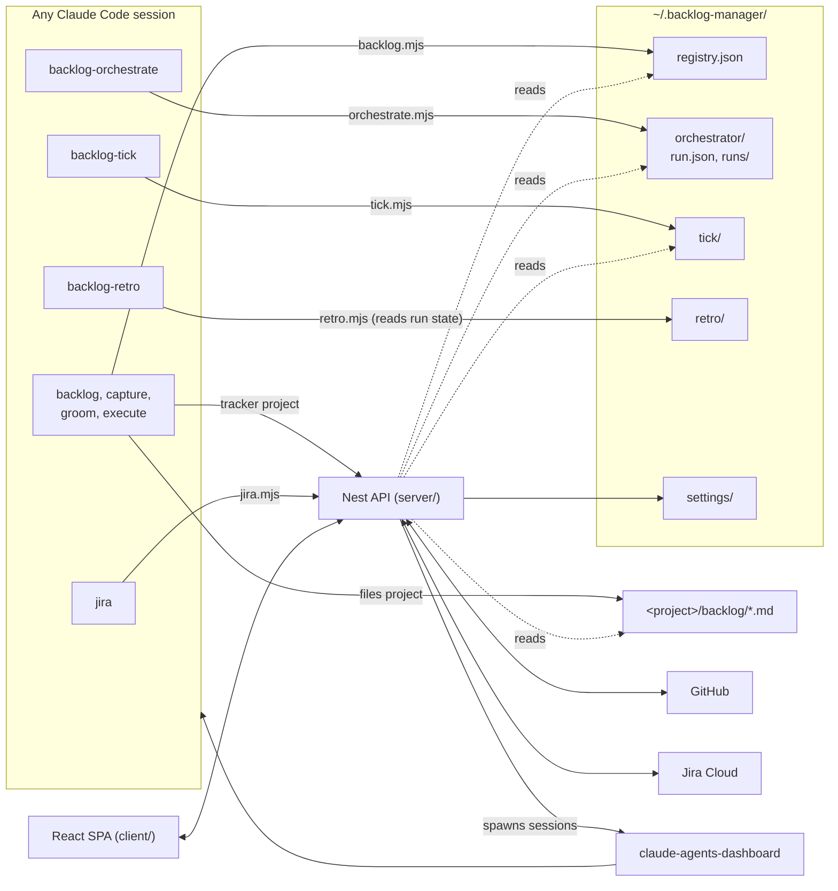

# backlog-manager

A [Claude Code](https://claude.com/claude-code) plugin that gives every repo a backlog Claude can work on its own, plus a local web board that shows every
project's backlog in one place.

You file bugs, ideas, tasks and refactors from any Claude Code session. Claude grooms them into plans, executes the groomed ones, and can drain a whole queue
unattended — each item in its own git worktree, reviewed and verified before it merges. The board collects every registered project's items, across every repo
the skills have touched, into one kanban-by-type board, and it can start that work, watch the runs, and merge the pull requests they open.

## What you can do

- **Capture** a bug, an idea, a task, a refactor or something already decided against, from any session — `/backlog-capture`. Each item is one Markdown file
  under that project's own `backlog/`, or a GitHub issue in a project connected to a tracker.
- **Groom** an item into something executable — `/backlog-groom`: promote an idea or a refactor into a task with a real plan, fill in a bug's Cause and Fix, or
  close it out as out of scope.
- **Execute** a groomed bug or task — `/backlog-execute`: debug and fix, or build out the plan, then archive the item once verification proves it worked. With
  `--finish pr` it works in its own worktree and ends in a commit, a review, a push and a pull request.
- **Drain the queue unattended** — `/backlog-orchestrate`: every ready bug and task, one at a time, each reviewed and verified, then merged into a base branch,
  left as a branch per item, or collected into one pull request per run.
- **Schedule it** — `/backlog-tick`, which a scheduled dashboard job fires to do one unattended unit of work when the project is idle: an execute to a PR, or a
  groom into a plan a person must approve.
- **Measure it** — `/backlog-retro` sweeps every orchestrator run on the machine into one report of what the pipeline cost, where the time went and how much of
  it was rework.
- **Work Jira tickets** — `/jira` reads a ticket, moves it through its workflow, assigns it, and makes its git worktree in a mapped repo.
- **See and steer everything from one board** — every project's items, open pull requests, live and finished runs, and Jira boards; start a groom, an execute or
  an orchestrator run from a card, on this machine or another one; read it from your phone over Tailscale.

## How it works

### The store format

Every registered project's backlog lives at `<project>/backlog/`, one Markdown file per item, one directory per section:

| Section      | Prefix | Lifecycle    |
| ------------ | ------ | ------------ |
| bugs         | bug    | open -> done |
| ideas        | idea   | open -> done |
| tasks        | task   | open -> done |
| refactors    | ref    | open -> done |
| out-of-scope | oos    | flat         |

An item's status is the directory it lives in (`open/` vs `done/`), never a frontmatter field. `out-of-scope/` has no `open/done` split — an item lands there
once and stays; rejection is terminal. Ideas and refactors are the two sections nothing executes directly: what each waits for is to be _promoted_ into a task,
which is `/backlog-groom`'s job — an idea is something new, a refactor an existing thing that should be improved.

The life of an item:

```
/backlog-capture ──> open/ ──> /backlog-groom ──> groomed ──> /backlog-execute  ──> done/
                       │        (idea, refactor          (bug: Cause + Fix;    or /backlog-orchestrate
                       │         promoted to a task)      task: a Plan)        or /backlog-tick
                       └──> /backlog-groom rejects it ──> out-of-scope/
```

"Groomed" is derived from the file, never stored: a bug is groomed once its Cause and Fix are filled in, a task once its Plan is non-empty.

The skills write items into whatever project they were run in. Every `init` or `new` call registers the project's absolute path in
`~/.backlog-manager/registry.json`. This app reads that registry and renders every registered project's items in four fixed columns — refactoring, ideas, bugs,
tasks. Items that were decided against are not on the board at all: out-of-scope is a record rather than queue work, and it lives in Archive.

### The skills

| Skill                  | What it does                                                                                                     | CLI it drives        |
| ---------------------- | ---------------------------------------------------------------------------------------------------------------- | -------------------- |
| `/backlog`             | Prints the open board for the current repo; never writes                                                         | `backlog.mjs`        |
| `/backlog-capture`     | Files one new item, creating the store if the repo has none                                                      | `backlog.mjs`        |
| `/backlog-groom`       | Promotes, plans, fills in a bug's Cause and Fix, or rejects; commits only in `--finish pr` mode                  | `backlog.mjs`        |
| `/backlog-execute`     | Does the work on a groomed bug or task and archives it; commits only in `--finish pr` mode                       | `backlog.mjs`        |
| `/backlog-orchestrate` | Drains the groomed queue, one worktree and one headless execute session per item; the only skill that merges     | `orchestrate.mjs`    |
| `/backlog-tick`        | One unattended unit per scheduled tick, only when the project is idle; never merges                              | `tick.mjs`           |
| `/backlog-retro`       | Sweeps every orchestrator run into a report and a pick-list of items, then records the sweep                     | `retro.mjs`          |
| `/jira`                | Reads and moves one Jira ticket through this machine's API, and makes its worktree on a Jira Run                 | `jira.mjs`           |

The plugin also ships one agent, `backlog-manager:backlog-reviewer`: the read-only reviewer `/backlog-orchestrate` dispatches before every merge, and
`/backlog-execute` before it pushes in `--finish pr` mode.

### Orchestrator runs

`/backlog-orchestrate` is the largest of the skills and the only one that merges — `/backlog-execute` and `/backlog-groom` in `--finish pr` mode open a PR and
may arm GitHub auto-merge on it, but GitHub does that merge, never the skill. Told to drain a project's groomed queue, it works every ready bug and task one at
a time — each in its own git worktree and its own headless `/backlog-execute` session — then commits that item, has it reviewed and verified, and merges it into
the run's base branch before the next one starts — `main` unless the run was started with `--base <ref>`, which lets a whole phased feature be drained onto a
branch with `main` never written. Told to leave branches instead, it stops at a reviewed `backlog/<id>` branch per item and merges nothing at all. On a project
whose items are GitHub issues it can also drain onto a run branch of its own and end by opening one pull request into the base for the whole run. A run's state
lives in a `run.json` outside the repo, under `~/.backlog-manager/orchestrator/`; the app reads that file to render live runs, run history, and the watchdog
that resumes a crashed run.

Start runs from the board's Orchestrate control rather than by typing the trigger into a terminal: the board composes the prompt, picks the merge mode, and can
pause, resume or stop the run afterwards.

### What the app writes, and what it does not

- **No auth, no database.** The registry file and each project's `backlog/` directory ARE the data; there is nothing here to log into.
- **The app writes no item files.** Filing, grooming, executing and moving items all happen through the skills — at the CLI, inside Claude Code, or in a session
  the board itself spawned. What the board can do is start that work (a dispatch, or an orchestrator run — on this machine or on another machine's dashboard),
  pause, resume or stop a run, and save its own server-side settings under `~/.backlog-manager/settings/` (the run watchdog's, the tick breaker's, the remote
  dashboards list, the Jira setup, the shared time zone); every item on screen is rendered from what is already on disk. A project connected to a tracker has no
  item files at all: there the skills' writes reach GitHub through this app's API, which holds the credential — see [Architecture](#architecture).
- **Its writes outside your disk are a short, closed list.** A tracker project's issues, through eleven guarded `/api/items/*` routes; an open pull request's
  merge, auto-merge and update-branch, from GitHub › PRs; a Jira issue's assignee and status. Nothing else is written to GitHub or Jira, and the server never
  writes git.

### Architecture



Solid arrows write, dotted arrows only read. The browser talks to the API alone — never to GitHub, Jira or the dashboard — and every token stays in the server
process.

A project connected to a tracker takes one detour through that picture and nothing else changes: its items are GitHub issues rather than files, so `backlog.mjs`
routes every command through the API (which holds `BM_GITHUB_TOKEN` and does the writing) instead of touching `<project>/backlog/*.md`. The board, the skills
and the orchestrator read exactly the same shapes either way. Connect one with `backlog.mjs connect github <owner>/<repo>`; the stack has to be running for any
command in a connected project, and a refused connection is exit `5` saying so. Move an existing files project with `backlog.mjs import github`; it writes the
marker first, one issue per item, and deletes the files only once every cross-link has been rewritten.

## Setup

### 1. Requirements

- Node 22.13+ (the floor `engines.node` in `package.json` declares; the image ships Node 24)
- pnpm 12+ (`corepack enable`, then `corepack prepare --activate` in this repo)
- Docker, if you want the containerized stack rather than running the two Node processes on the host
- Claude Code, for the skills
- Optional: [claude-agents-dashboard](https://github.com/futin/claude-agents-dashboard), for starting sessions from the board; Tailscale, for reading the board
  from your phone

### 2. Install the skills

The repo is its own plugin marketplace:

```
/plugin marketplace add /path/to/backlog-manager
/plugin install backlog-manager@backlog-manager-marketplace
```

That gives every project `/backlog`, `/backlog-capture`, `/backlog-groom`, `/backlog-execute`, `/backlog-orchestrate`, `/backlog-tick`, `/backlog-retro` and
`/jira`, plus the read-only reviewer agent `backlog-manager:backlog-reviewer`. (An install carries `agents/` because a marketplace with no `sparsePaths` clones
the whole repo; if your own declaration in `~/.claude/settings.json` pins that key, it has to list `agents` alongside `skills` or the reviewer is invisible in
the install.)

A skill edit in this repo reaches other sessions only after it is pushed and `pnpm run plugin:sync` reinstalls the plugin
([publishing](docs/workflows/publishing.md)).

If you ran these skills before this repo existed, they are still sitting in `~/.claude/skills/` and will now load a second time alongside the plugin's copies,
which then drift apart. Remove them once the plugin is installed:

```bash
rm -rf ~/.claude/skills/backlog ~/.claude/skills/backlog-capture \
       ~/.claude/skills/backlog-groom ~/.claude/skills/backlog-execute
```

### 3. Register a project

`init` and `new` both register the current project in the real registry, so a project appears on the board the first time a skill files or scaffolds an item in
it — no separate registration step. In any repo, `/backlog-capture` your first item and you are done.

Registering a project without capturing anything:

```bash
cd /path/to/some/project
node <plugin-cache-path>/skills/backlog/tools/backlog.mjs init
```

### 4. Start the board

```bash
cp .env.example .env
pnpm run docker:up
```

That brings up two containers — the Nest API on `:4322` and the Vite dev server on `:5177` — with no database service. Open whichever suits you:

| URL                     | What it is                                                                  |
| ----------------------- | --------------------------------------------------------------------------- |
| `http://localhost:5177` | Vite dev server: hot reload, proxies `/api` through to the API container    |
| `http://localhost:4322` | The API directly, and the built client bundle once `pnpm run build` has run |

The server container sees only the tree mounted from `BM_PROJECT_ROOT` (default `~/Documents/custom-projects`), so set it in `.env` to the directory that holds
your repos. A project outside `BM_PROJECT_ROOT` is invisible to the container and is reported as missing on `/api/projects` rather than silently dropped from
the board — widen the mount if you keep backlogs elsewhere.

`pnpm run docker:down` stops it; `pnpm run docker:sync` tears down and rebuilds — useful after a dependency change, since `node_modules` lives in a named volume
seeded from the image rather than in the bind mount.

Using the board rather than working on it? `pnpm run docker:run` builds once and runs a single container that serves the built client from the API — same URLs
(`:5177` and `:4322`), no Nest watcher or Vite, and roughly 700 MiB less resident than the dev stack. It does not reload: rerun it after pulling, or go back to
`pnpm run docker:up` for hot reload. See [`docker-compose.run.yml`](docker-compose.run.yml).

To run the Node processes on the host instead, install the dependencies first — the Docker route never needs this, because the image does its own install:

```bash
pnpm install
pnpm run dev      # the API, in one shell
pnpm run dev:web  # the client, in another
```

No database to start first.

### 5. Optional: back a project with GitHub issues

Set `BM_GITHUB_TOKEN` in `.env` (the scopes it needs are in [Configuration](#github)), restart the stack, then in the project run `backlog.mjs connect github
<owner>/<repo>` for an empty store or `backlog.mjs import github` to move an existing one. From then on the project's items are issues, its claims are issue
comments, and GitHub › PRs lists its open pull requests. The commands and what each refuses are in [the skills doc](docs/subsystems/skills.md).

Tracker behaviour worth knowing: a claim is one issue comment per session, and the lowest live comment id wins; an issue filed by someone outside the repo
cannot be executed until a groom of ours pins its body; and an `in-review` item becomes ready again by itself once the latest PR referencing it (`Closes`,
`Fixes`, `Resolves` or `Refs #n`) merged into the default branch.

### 6. Optional: dispatch to Claude

With [claude-agents-dashboard](https://github.com/futin/claude-agents-dashboard) running beside this repo (as `../claude-agents-dashboard`), a card's button
hands that item to a real Claude Code session: an idea gets groomed into a task, an ungroomed bug gets its Cause and Fix filled in, an ungroomed task — rare,
since capture refuses to create one without a Plan — gets one filled in, and a groomed bug or task gets executed. The board calls this API, this API calls the
dashboard's `POST /api/spawn`, and the session shows up in the dashboard a poll later — where you can watch it, and answer its questions from a phone if its
hooks are installed.

Off until you set `BM_AGENTS=on` (plus `BM_AGENTS_URL`, or `BM_AGENTS_DOCKER_URL` when the stack is doing the calling, and `BM_AGENTS_TOKEN` if the dashboard
sets `ANSWER_TOKEN`). **Settings ▸ Dashboards** (Home's detail) reports exactly which gate is closed and what to do about it. The action is derived from the
item file, not from the click, so an ungroomed bug cannot be executed by asking nicely — and nothing here ever writes an item: the spawned session runs the
skills, which remain the only writers.

On a Mac whose dashboard can open sessions in the Claude desktop app (its `/api/health` says `desktopAvailable`), the launch sheet for a single item's execute
or groom also offers **Dashboard | Desktop**, preselected from the dashboard's own default. Desktop hands the session to the app on that Mac instead of the
dashboard's headless `claude`; the app mints its own session id, so the board keeps no dispatch record for it, and the session is the app's to follow and stop.
Home only — a launch on another machine never offers it.

A second machine that runs its own dashboard and its own board can take that work too: add it on Settings ▸ Dashboards, and every launch sheet for a tracker
project registered on both boards grows a `Run on` group with a card per machine. The server calls the remote dashboard — never the browser — under the same
`BM_AGENTS` switch; the setup, including the `BM_MACHINE_NAME` both sides must agree on, is
[`docs/workflows/remote-machine.md`](docs/workflows/remote-machine.md).

The board's Orchestrate control goes out the same way and through the same switch: with `BM_AGENTS` off there is nothing to spawn a run with. Pausing or
cancelling a live run is deliberately not gated on it — a pause is a fact on this machine's own disk and calls nothing outbound, so it keeps working after that
switch is turned off, which is what stops a run started while agents were on from becoming unstoppable. Stopping a run is the same: the stop request is written
either way, and only the `--abort` session it then tries to spawn needs the switch — with it off, the response says to run `/backlog-orchestrate --abort` at the
project root by hand.

### 7. Optional: connect Jira

Set all three of `BM_JIRA_SITE`, `BM_JIRA_EMAIL` and `BM_JIRA_TOKEN` (see [Configuration](#jira)), and point `BM_JIRA_REPO_ROOT` at the directory holding the
repositories your Jira projects map to. The Jira section then appears in the rail: add boards and map repos on Jira › Setup, and a card's Run ▾ starts a session
in the ticket's worktree or copies its prompt. The whole integration is in [the Jira doc](docs/subsystems/jira.md).

### 8. Optional: read it from your phone

The web port is published on `127.0.0.1` only, and Tailscale is what puts it on the network: `pnpm run tailnet` registers a `tailscale serve` proxy from this
node's own tailnet address to that loopback port, on the same port number.

```bash
pnpm run docker:up
pnpm run tailnet
```

The second command prints the URL to open on the phone — for example `http://my-box.tailXXXX.ts.net:5177`. Subcommands:

| Command                   | What it does                                                    |
| ------------------------- | --------------------------------------------------------------- |
| `pnpm run tailnet`        | Register the serve, print the tailnet URL                       |
| `pnpm run tailnet status` | What tailscaled is serving, plus whether the local port answers |
| `pnpm run tailnet down`   | Unregister                                                      |

The registration persists across reboots, so this is a once-per-machine step rather than part of the daily loop. It reads `BM_WEB_PORT` from `.env` — the same
value compose reads — so the tailnet port and the local port are always the same number, and changing one changes both. That matters with several projects on
one machine: each one's port is its own name, and there is no second copy of it inside tailscaled to drift out of date. Nothing is listening yet is a warning
rather than an error; the registration is still made.

The web port is the only one on the tailnet. The API port answers the same board once `pnpm run build` has run, but it is loopback-bound like everything else
and gets no serve of its own — put one in front of `BM_API_PORT` yourself if you want to read the production bundle from the phone instead of the dev server.

Requirements: Tailscale on this machine and on the phone, both logged into the same tailnet, and MagicDNS on for the name to resolve (the `100.x` address works
either way). It is reachable from anywhere — cellular, another country — not just your local network; if the two devices cannot open a direct path, Tailscale
relays. Nothing outside your tailnet can reach it, which is the whole access control here. This machine has to be awake.

`serve` edits the node's configuration, so tailscaled refuses it unless you are root or the declared operator. The script prints the fix rather than running it:
`sudo tailscale set --operator=$USER`.

`vite.config.ts` allowlists `.ts.net` hosts — without that, Vite 5.4.12+ answers a tailnet name with a 403 rather than the app. One catch when editing that
file: Vite's in-place restart comes back bound to localhost inside the container and the published port then refuses connections, so run `docker compose restart
client` after touching it.

**With `BM_AGENTS` on, this publishes more than a read surface.** Every device logged into your tailnet can then reach `POST /api/agents/dispatch`,
`/orchestrate` and `/dispatch-jira`, each of which spawns a Claude Code session with file-write permission in another repo. The tailnet is the only boundary in
front of that, so treat the serve as a deliberate decision rather than part of the default setup.

#### Why plain HTTP

The URL says `http://`, but nothing crosses the internet in the clear: the hop between phone and this machine is WireGuard-encrypted end to end, and the HTTP
exists only inside that tunnel, between tailscaled and a loopback socket. The dispatch POSTs work through it because the origin guard compares host and port and
not the scheme — a serve that terminated TLS would otherwise 403 itself.

The browser will still mark it Not secure, and secure-context APIs (service workers, clipboard, `getUserMedia`) stay unavailable. Nothing here needs one. If
that ever changes, `tailscale serve --bg --https=443 http://127.0.0.1:$BM_WEB_PORT` gets a real Let's Encrypt cert on the node's MagicDNS name — at the cost of
the matching-port property, since `--https` accepts only 443, 8443 and 10000.

Do not use `tailscale funnel` for this. Funnel publishes to the public internet, and this board reads every registered project's backlog files off this
filesystem with no authentication in front of them. Avoid mounting the app under a path (`--set-path`) either — the SPA references `/assets` and `/api`
absolutely, so it breaks anywhere but a root.

## What the board shows

Five sections behind a side rail, each loaded on first visit. A source's section is drawn only while some registered project has that source.

- **Files** and **GitHub** — a Board and an Archive per source. The Board is four kanban columns by type; a card carries its derived state (groomed, claimed, in
  review, queued for a run) and the one action it allows. A filter picks out the plans a tick groomed that wait for a person's approval (`plan-review`); a
  tracker plan is approved from its modal, a files plan by a prompt the modal copies. Items untouched for 30 days move to Archive on their own ([what leaves the
  Board](docs/subsystems/board.md#what-leaves-the-board)).
- **GitHub › PRs** — every open pull request on the registered GitHub repos, drawn as Inbox, Matrix or Cards, with chips for draft, review, checks, conflicts,
  behind-base and auto-merge. Every layout carries the same keys — `Merge`, `Auto-merge`, `Update` and `Open ↗` — and one foot under the row: Merge asks once
  there, with the method picker inside its confirm, and the outcome line follows (`branch updated` once an update lands). A blocked action is disabled with its
  reason beside it. GitHub › Settings holds each repo's sync interval.
- **Jira** — drawn only while the three `BM_JIRA_*` credentials are set. Board shows the synced Jira boards, with assign and transition; Setup holds the boards,
  the repositories each project maps to, and the skills a Run can start. A card's Run ▾ starts a session in the ticket's worktree, or copies its prompt.
- **Runs** — History (live and finished orchestrator runs, their cost, time and rework, with pause, resume and stop), Watchdog (the sweeper that resumes a
  crashed run) and Ticks (each project's tick record, its halt, and its Reset).
- **Settings** — Local (this browser), Shared (this machine: time zone, tick caps, each source's token status) and Dashboards (the home dashboard's gates and
  the other machines this board can launch on).

Two chips sit above the well while a source is connected: the GitHub poller's POLL and API meters, and Jira's. A version chip at the foot of the rail opens a
**What's new** drawer with every release ([releases](docs/subsystems/releases.md)).

One behaviour worth knowing before it surprises you: an open refactor, idea or bug nobody has touched inside the staleness window (30 days by default, `Settings
→ Local → Board → Archive after`) leaves the Board for Archive on its own — so the first load after upgrading moves genuinely old, never-touched items across.
Nothing is lost: grooming one puts it back at the next load, and a task never leaves at all. How "touched" is decided, and the two things that outrank it, are
in [the board doc](docs/subsystems/board.md#what-leaves-the-board).

_Screenshot not yet captured — open `http://localhost:5177` after `pnpm run docker:up` (or `pnpm run dev` plus `pnpm run dev:web`) once the board has real items
on it, and drop the image at `docs/board.png`._

## Configuration

Everything lives in `.env`, and `.env.example` documents each key — except the rows marked "Not in `.env.example`" below (`BM_ORCH_HOME`,
`BM_ORCH_CONTROL_HOME`, `BM_TRACKER_SYNC_FILE`, `BM_JIRA_FILE`, `BM_TICK_FILE`, `BM_TICK_HOME`, `BM_DASHBOARDS_FILE`, `BM_TIMEZONE_FILE` and
`BM_AGENTS_TOKEN_<NAME>`), which are read straight from the process environment.

### Core

| Key                           | Default                            | Purpose |
| ----------------------------- | ---------------------------------- | ------- |
| `PORT`                        | `4322`                             | API port, and the port the built client bundle is served from |
| `BM_REGISTRY_FILE`            | `~/.backlog-manager/registry.json` | Where `backlog.mjs` writes |
| `BM_BIND`                     | `127.0.0.1`                        | Interface both processes bind. Compose sets `0.0.0.0` inside the containers, where the loopback publish is the boundary |
| `BM_ALLOWED_HOSTS`            | empty                              | Extra `Host` names this API answers to, comma-separated (a leading `.` is a suffix match). IP literals, `localhost` and `.ts.net` names are always allowed; everything else is refused with 403, because a `Host` allowlist is what a DNS-rebound page cannot pass |
| `BM_WEB_PORT` / `BM_API_PORT` | `5177` / `4322`                    | Host-side ports, for when something else already holds one. `BM_API_PORT` is also what the skills dial in a tracker-connected project — `backlog.mjs` routes every command through it, because the GitHub credential lives in the server process and nowhere else |
| `BM_PROJECT_ROOT`             | `~/Documents/custom-projects`      | The tree mounted read-only into the server container |
| `BM_REPO_ROOTS`               | set by compose                     | Both roots (`BM_PROJECT_ROOT` and `BM_JIRA_REPO_ROOT`), `:`-joined, each with its mount's default — compose sets it for the server container, so do not set it yourself. It lets the server tell a path outside every mount from a missing one; unset on a host-run API, where that check is skipped |
| `BM_MACHINE_NAME`             | `<user>@<host>`                    | The machine name a tracker claim records, read by `backlog.mjs` and `orchestrate.mjs` from their own environment, and by this server (through compose) only for the board's **Release claim** on a session it did not dispatch, which it refuses unless the claim's host equals this name — or, for a STALE claim, only to ask the dashboard whether a holder on this machine is still working before releasing it or dispatching over it. Set it in both places. On a public repository the claim comment publishes it, so set a name you chose rather than publish your OS username and hostname |

### Dispatch and the watchdog

| Key                      | Default                                     | Purpose |
| ------------------------ | ------------------------------------------- | ------- |
| `BM_AGENTS`              | off                                         | Turns on dispatching backlog items to `../claude-agents-dashboard` |
| `BM_AGENTS_URL`          | `http://127.0.0.1:4173`                     | The dashboard's API origin — its `PORT`, not its Vite port. The host-side answer; compose deliberately never interpolates this key |
| `BM_AGENTS_DOCKER_URL`   | `http://host.docker.internal:4173`          | The same origin as seen from inside the server container. Set it when that default does not reach your host — under WSL2 it resolves and then refuses, and the bridge gateways refuse it too, so use one of the host's own interface IPs (prefer a tailnet address, which survives a reboot) |
| `BM_AGENTS_TOKEN`        | empty                                       | Sent as `Authorization: Bearer …` when the dashboard sets `ANSWER_TOKEN` |
| `BM_AGENTS_TOKEN_<NAME>` | empty                                       | A remote dashboard's bearer token: `BM_AGENTS_TOKEN_` plus the name of its Settings › Dashboards entry, uppercased (`BM_AGENTS_TOKEN_PRO` for `Pro`). Read per call, and a missing one sends no `Authorization` header — the tailnet path needs none. Never typed into the board, which reports only whether it is set ([setup](docs/workflows/remote-machine.md)). Not in `.env.example` |
| `BM_WATCHDOG_FILE`       | `~/.backlog-manager/settings/watchdog.json` | Where the server itself writes the run watchdog's own settings |
| `BM_WATCHDOG`            | on                                          | `off` disables the run watchdog entirely — the operator's kill switch, separate from its Settings toggle |

### GitHub

| Key               | Default | Purpose |
| ----------------- | ------- | ------- |
| `BM_GITHUB_TOKEN` | empty   | The credential the tracker poller and GitHub › PRs read for every project whose committed `backlog/source.json` names GitHub. A fine-grained token needs Issues read and write, Pull requests read and write, Contents write, Checks and Commit statuses read (a classic one, `repo`); `.env.example` says why each. A write the token may not make fails with GitHub's own message. Absent is a supported state (the poller stays disarmed and the Sources card says `no token`). Process-only — it reaches no payload, no URL and no log line, and the browser never talks to GitHub |

### Jira

| Key                 | Default                       | Purpose |
| ------------------- | ----------------------------- | ------- |
| `BM_JIRA_SITE`      | empty                         | The Jira Cloud site, as a hostname only (`acme.atlassian.net`) — no scheme, path, port or query; the server always speaks `https://` and builds every URL itself. One of three Jira credentials, all or none: any one missing or blank reads as not configured, and the Jira poller stays disarmed ([doc](docs/subsystems/jira.md)) |
| `BM_JIRA_EMAIL`     | empty                         | The Atlassian account `BM_JIRA_TOKEN` belongs to — half of the Basic credential, so it stays in the server process exactly as the token does |
| `BM_JIRA_TOKEN`     | empty                         | An Atlassian API token: a scoped one needs `read:jira-work`, `write:jira-work` and `read:jira-user`, a classic one works as it is. Process-only — no route returns it or the email, and the browser never talks to Jira |
| `BM_JIRA_REPO_ROOT` | `~/Documents/timify-projects` | The second tree mounted read-only into the server container, at the same path: the repositories a Jira project is mapped to (Setup → Repositories). The server reads their branches and worktrees for the launch sheet and never writes them; a mapped repo outside both roots reads as `not mounted into the board`. A path that does not exist is created by Docker's bind mount, as an empty directory (root-owned on Linux), so set it to a directory that already exists |

### State and settings files

Paths the tools and the server keep their state in. None of them is in `.env.example`; the defaults suit almost everyone.

<details>
<summary>Eight path overrides</summary>

| Key                    | Default                                             | Purpose |
| ---------------------- | --------------------------------------------------- | ------- |
| `BM_ORCH_HOME`         | `~/.backlog-manager/orchestrator/`                  | The orchestrator's run-state directory: `orchestrate.mjs` writes each run's `run.json` there and archives each finished run under `runs/` — its run file as `runs/<runId>.json` and its sidecars (transcripts, reviewer reports, verify output) as the sibling directory `runs/<runId>/` — and this server only ever reads it. Not in `.env.example` |
| `BM_ORCH_CONTROL_HOME` | `~/.backlog-manager/settings/orchestrator-control/` | Where this server writes a pause or stop request, which a live run reads back at its dispatch gates — the one file travelling server to tool. Not in `.env.example` |
| `BM_TRACKER_SYNC_FILE` | `~/.backlog-manager/settings/tracker-sync.json`     | Where this server writes each connected repo's tracker sync interval — the one control on GitHub › Settings' Sync card (`server/src/tracker/sync-config.util.ts`). Not in `.env.example` |
| `BM_JIRA_FILE`         | `~/.backlog-manager/settings/jira.json`             | The per-machine Jira settings (`{ boards, repos, repoDefaults, skills }`). The server reads it and writes it through six guarded routes, `POST /api/jira/boards`, `/boards/delete`, `/repos`, `/repo-defaults`, `/skills` and `/skills/delete`. Not in `.env.example` |
| `BM_TICK_FILE`         | `~/.backlog-manager/settings/tick.json`             | The tick's settings: how many failed ticks in a row halt a project, and the plan-review and open-PR caps a tick job applies when its prompt carries no `--max-plans` / `--max-prs` flag (Settings › Shared › Backlog tick; a job's flag still wins), and when each project was last Reset (Runs › Ticks). The server writes it through `POST /api/ticks/config` and `/reset`; `tick.mjs` reads it. A file that cannot be read is never replaced. Not in `.env.example` |
| `BM_DASHBOARDS_FILE`   | `~/.backlog-manager/settings/dashboards.json`       | The other machines' dashboards this board can start work on, plus the strategy, threshold and prefer order its machine suggestion reads. The server writes it from Settings › Dashboards; a file that cannot be read is never replaced, and its remotes are ignored until it is fixed. No file means home-only. Not in `.env.example` |
| `BM_TICK_HOME`         | `~/.backlog-manager/tick/`                          | Where `tick.mjs` keeps each project's `state.json` and lock — its one writer. The server only reads it, per call, for Runs › Ticks and a project's halt; a Reset is written to `tick.json`, never here. Not in `.env.example` |
| `BM_TIMEZONE_FILE`     | `~/.backlog-manager/settings/timezone.json`         | The board's one shared time zone (Settings › Shared), which every clock, day group and date on the board is drawn in. The server writes it through `POST /api/settings/timezone`; no file, or one that does not parse, means each browser keeps its own zone. Not in `.env.example` |

</details>

### Ports and binds

Ports: API `4322`, Vite `5177`. Only the host side moves, via `BM_API_PORT` / `BM_WEB_PORT` in `.env` — inside the compose stack they are fixed. In a project
connected to a tracker, `BM_API_PORT` is also what the skills dial, so the stack has to be up for any `backlog.mjs` command there. On the host both processes
bind `127.0.0.1`, and under compose both ports publish on `127.0.0.1` — nothing here has auth in front of it, so loopback is the access control. `BM_BIND` moves
the bind if you really need to; to reach the board from another device, put a `tailscale serve` in front of the loopback port instead — `pnpm run tailnet` is
that command, see [Read it from your phone](#8-optional-read-it-from-your-phone).

## Development

| Task                                    | Command                                         |
| --------------------------------------- | ----------------------------------------------- |
| Whole stack (api + client, no database) | `pnpm run docker:up`                            |
| Rebuild the stack from scratch          | `pnpm run docker:sync`                          |
| Board only, built, no watchers          | `pnpm run docker:run`                           |
| Stop the stack                          | `pnpm run docker:down`                          |
| API only, on the host                   | `pnpm run dev`                                  |
| Client only, on the host                | `pnpm run dev:web`                              |
| Tests (both runners: jest, then node)   | `pnpm test`                                     |
| Tests, jest only, on its worker pool    | `pnpm run test:jest`                            |
| Skill tests (node:test)                 | `pnpm run test:skills`                          |
| Reinstall the plugin from pushed HEAD   | `pnpm run plugin:sync`                          |
| Publish the web port to the tailnet     | `pnpm run tailnet` (`up` \| `status` \| `down`) |
| Types (`tsc --noEmit`)                  | `pnpm run typecheck`                            |
| Production build (nest + vite)          | `pnpm run build`                                |

Jest suites are flat in `test/`; node suites sit beside the tool they cover. Component suites opt into jsdom with a `@jest-environment jsdom` docblock;
everything else runs in node.

Ports, binds, what the container mounts and the failure modes each of those has are in [`docs/workflows/development.md`](docs/workflows/development.md).

### Pull requests and releases

`main` merges squash-only, so a PR's title becomes the commit, and `ci / pr-title` checks it: `feat|fix|perf` (`!` allowed) or
`docs|chore|test|refactor|ci|build`, an optional lowercase `(scope)`, then `: ` and a description. A `feat`, `fix` or `perf` PR also needs a `## What's new`
section in its body (or `None — <reason>`), which becomes its release note. CI ([`docs/workflows/ci.md`](docs/workflows/ci.md)) runs the full suite on every
code PR and a scoped one on a docs-only or skills-only PR, so there is no need to run all of `pnpm test` locally before pushing.

Releases are nightly rollups: `.github/workflows/release.yml` runs at 04:17 UTC and cuts one version for everything merged that day.

## Docs

[`docs/overview.md`](docs/overview.md) is the map, and the one place that lists every doc. Six docs, one per seam plus the rationale:

- [**The API**](docs/subsystems/api.md) — Nest, every route under `/api`. Reads the registry, each project's store and the orchestrator's run state; the only
  thing here that can spawn a session, and only when `BM_AGENTS` says so. Its tracker module also holds the GitHub › PRs cache (one GraphQL query per repo, kept
  60 s, fetched on demand) behind `GET /api/prs` and its three guarded writes.
- [**The board**](docs/subsystems/board.md) — the React SPA: five lazy sections behind a side rail, with most of what you see derived in the browser from whole
  corpora.
- [**The skills**](docs/subsystems/skills.md) — the eight published skills, their five CLIs, and the reviewer agent the orchestrator dispatches before a merge.
- [**Jira**](docs/subsystems/jira.md) — the Jira Cloud integration: a client, a board poller and its caches, nine read routes under `/api/jira`, six guarded
  config writes to `jira.json`, the two writes to Jira itself (`/issue/assign` and `/issue/transition`), the Run half in `agents/` (`POST
  /api/agents/dispatch-jira` and `/jira-stop`) with an in-memory map of live Jira sessions, and the `jira` skill (`jira.mjs`) that reaches those routes from any
  session and, on a Run, makes the ticket's git worktree in a mapped repo.
- [**Releases**](docs/subsystems/releases.md) — the rail's version chip and its What's new drawer, read from this checkout's release tags.
- [**Invariant rationale**](docs/subsystems/invariants.md) — the rules the other five are held to, and the failure each one encodes.

Four workflow docs cover the procedures: [running the app](docs/workflows/development.md), [publishing a skill edit](docs/workflows/publishing.md),
[CI](docs/workflows/ci.md) and [a second machine](docs/workflows/remote-machine.md).

## Repo layout

| Path       | Contents                                                                                                                                                                                                                                 |
| ---------- | ---------------------------------------------------------------------------------------------------------------------------------------------------------------------------------------------------------------------------------------- |
| `skills/`  | The eight published skills — the plugin's skill root ([doc](docs/subsystems/skills.md))                                                                                                                                                  |
| `agents/`  | The plugin's own agents; today just the orchestrator's reviewer ([doc](docs/subsystems/skills.md))                                                                                                                                       |
| `server/`  | Nest API — items, projects, item bodies, the registry reader, the agents module, the run reader, the tracker poller, the tick breaker's routes, the release tags reader, the remote dashboards ([doc](docs/subsystems/api.md)), the Jira routes ([doc](docs/subsystems/jira.md))                               |
| `client/`  | React SPA — side rail, Files and GitHub boards and archives, GitHub › PRs, run chip, runs, Jira, settings, What's new ([doc](docs/subsystems/board.md))                                                                                       |
| `shared/`  | Types, the derivations both sides must agree on (`agent.ts`), the Jira branch-name rule (`jira-branch.ts`), theme tokens                                                                                                                                                               |
| `backlog/` | This repo's own backlog marker — its items are GitHub issues since the repo connected itself to a tracker                                                                                                                                |
| `scripts/` | `sync-plugin.mjs` ([doc](docs/workflows/publishing.md)), `test-all.mjs` and `test-tmpdir.mjs`, the per-run temp root `test:skills` runs through ([doc](docs/workflows/development.md)), `tailnet.mjs`, the `tailscale serve` wrapper, and `ci-scope.mjs`, CI's one check command ([doc](docs/workflows/ci.md)) |
| `test/`    | Jest suites, flat; many read the client or server tree and pin its shape ([doc](docs/workflows/development.md))                                                                                                                         |
| `docs/`    | The reference docs — start at [`overview.md`](docs/overview.md); `superpowers/` is the design spec and implementation plans                                                                                                              |
| `audits/`  | Dated whole-repo audit reports                                                                                                                                                                                                           |

<!-- docs-sync:
  sources:
    - server/src
    - client/src
    - shared
    - skills
    - agents
    - scripts
    - package.json
    - docker-compose.yml
    - docker-compose.run.yml
    - Dockerfile
    - vite.config.ts
    - .env.example
    - pnpm-workspace.yaml
  kind: readme
  verified: c28be64165cc6cf9d1faa0d8ce2a9f47aae69bd8
-->
